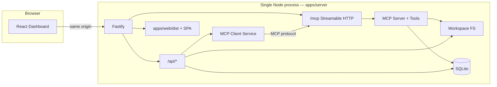

# Architecture

## System overview

**Production = one Fastify process, one origin.** The Vite build is served as static files + SPA fallback from the same server.

Development uses two processes: Vite (`:5173`) proxies `/api` and `/mcp` to Fastify (`:3847`). Source layouts stay in `apps/web` and `apps/server`.

## Packages

- `packages/shared` — shared types, Zod schemas, constants
- `apps/server` — Fastify (API + MCP + static), modules, security, `node:sqlite`
- `apps/web` — Vite + React dashboard (built into `apps/web/dist`)

## MCP vs REST

| Concern | Mechanism |
| --- | --- |
| Tool discovery / invocation | MCP `tools/list`, `tools/call` via SDK |
| Health, settings, history UI | Ordinary HTTP `/api/*` |
| Notes/files convenience for UI | HTTP wrappers over same modules (Tools page still uses MCP) |
| Frontend assets | `@fastify/static` + SPA `index.html` fallback (not for `/api` or `/mcp`) |

## Data layout

- `data/workspace` — sandboxed user files (not in public web dist)
- `data/db/toolkit.sqlite` — notes, executions, settings
- Logs via Pino to stdout

## Startup sequence (production)

1. Load/validate env (`SERVE_WEB=true` / `NODE_ENV=production`)
2. Ensure workspace + open SQLite + migrate
3. Register MCP tools into registry
4. Register API + MCP routes
5. Register static UI + SPA fallback
6. Listen (loopback by default)
7. Warm MCP client connection to `/mcp`
