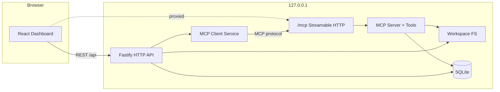

# Architecture

## System overview

## Packages

- `packages/shared` — shared types, Zod schemas, constants
- `apps/server` — Fastify, MCP server/client, modules, security, `node:sqlite`
- `apps/web` — Vite + React dashboard

## MCP vs REST

| Concern | Mechanism |
| --- | --- |
| Tool discovery / invocation | MCP `tools/list`, `tools/call` via SDK |
| Health, settings, history UI | Ordinary HTTP `/api/*` |
| Notes/files convenience for UI | HTTP wrappers over same modules (tools still go through MCP on Tools page) |

## Data layout

- `data/workspace` — sandboxed user files
- `data/db/toolkit.sqlite` — notes, executions, settings
- Logs via Pino to stdout (not under `apps/web`)

## Startup sequence

1. Load/validate env
2. Ensure workspace + open SQLite + migrate
3. Register MCP tools into registry
4. Listen on loopback
5. Warm MCP client connection to `/mcp`
