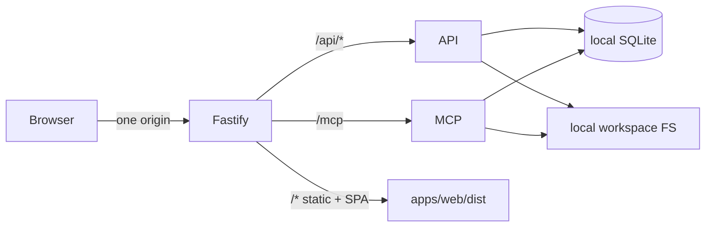

# Deployment

## Target architecture (single process)



Production startup:

```bash
npm run build
npm start
```

One Node process (`apps/server`) serves:

- REST `/api/*`
- MCP Streamable HTTP `/mcp`
- Vite-built UI from `apps/web/dist`

Development stays two processes (`npm run dev`): Vite on `:5173` proxies `/api` and `/mcp` to Fastify on `:3847`.

## Why not Vercel (serverless)?

This toolkit is **not compatible** with a fully functional Vercel serverless deployment:

| Requirement | Vercel serverless | This app |
| --- | --- | --- |
| Persistent SQLite file | Ephemeral / read-only FS | Required |
| Workspace filesystem tools | No access to your PC; no durable disk | Required for local tools |
| Long-lived MCP sessions | Request-scoped / short-lived | In-memory session map |
| `reply.hijack()` / streaming MCP | Fragile / unsupported patterns | Used by Streamable HTTP |
| Single always-on Node process | Functions scale to zero | Assumed |

A multi-service Vercel setup (separate frontend + backend) was intentionally avoided. Even a “single” Vercel project cannot give this app a durable local disk or your machine’s files.

**Deployed remote tools cannot access your personal computer.** Filesystem MCP tools only see the workspace directory on the machine where the Node process runs.

## Recommended hosting (least disruptive)

Prefer a **persistent Node.js host** (same `npm run build && npm start` pipeline):

1. **Local / LAN** (best fit) — `HOST=127.0.0.1` or bind LAN with `ALLOW_NON_LOOPBACK=true`
2. **VPS / Docker** — Fly.io, Railway, Render (native Node), DigitalOcean, etc.
3. **Self-hosted reverse proxy** — Caddy/Nginx → Node on one origin

Example production env for a remote Node host:

```env
HOST=0.0.0.0
PORT=3847
ALLOW_NON_LOOPBACK=true
PUBLIC_ORIGIN=https://toolkit.example.com
ALLOWED_HOSTS=toolkit.example.com
ALLOWED_ORIGINS=https://toolkit.example.com
WORKSPACE_PATH=/var/lib/local-mcp/workspace
DATABASE_PATH=/var/lib/local-mcp/toolkit.sqlite
SESSION_TOKEN=<long-random-secret>
SERVE_WEB=true
NODE_ENV=production
```

Mount durable volumes for `WORKSPACE_PATH` and `DATABASE_PATH`.

## Docker (optional sketch)

```dockerfile
FROM node:24-bookworm-slim
WORKDIR /app
COPY package*.json ./
COPY apps ./apps
COPY packages ./packages
COPY data ./data
COPY scripts ./scripts
RUN npm ci && npm run build
ENV NODE_ENV=production SERVE_WEB=true HOST=0.0.0.0 PORT=3847
EXPOSE 3847
CMD ["npm", "start"]
```

## Vercel config in this repo

`vercel.json` exists only to document that this project is **not** intended for Vercel serverless. Do not expect filesystem tools or SQLite persistence there. Use a persistent Node host instead.
